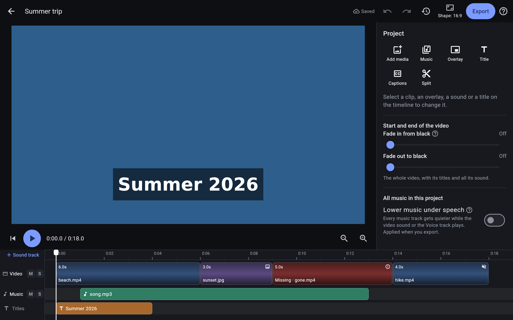

# ClipForge

A free, simple video editor for Windows, Mac and Android. Trim clips, add
titles, captions and music, clean up sound and export, on a computer or a
phone. Made for family videos, podcast clips and sport clips.

## Download

**[Download ClipForge](https://ekharam-png.github.io/clipforge/)** (Windows,
Mac and Android, with install steps). All versions are on the
[Releases](https://github.com/ekharam-png/clipforge/releases) page.

ClipForge is a beta, made for personal use, and comes with no warranty.

## For developers

The app is a Flutter project in [`video-editor/`](video-editor/). See
[`video-editor/README.md`](video-editor/README.md) for building, testing and
the Claude control server, and [`video-editor/CHANGELOG.md`](video-editor/CHANGELOG.md)
for what changed in each version.

## Licence

GNU General Public License version 3 ([LICENSE](LICENSE)). The app ships a
GPL build of FFmpeg. Third-party software is listed in
[`video-editor/README.md`](video-editor/README.md#third-party-software).
