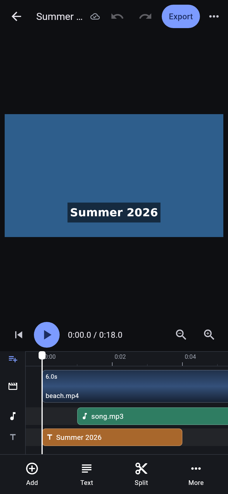

# ClipForge

A free, simple video editor for Windows, Mac and Android. Made for family
videos, podcast clips and sport clips.

## Why it exists

- **Simple.** The tools you need for short everyday videos, without a
  studio's worth of buttons.
- **Free, no subscription, no watermark.**
- **Works offline.** Your videos stay on your device; nothing is uploaded.
- **The same app on a phone and a computer.**
- **Claude can edit for you.** On a computer, Claude can cut, clean up,
  caption and export a project while you describe what you want.

## What it can do

| Area | Features |
|---|---|
| Cutting | Split, trim, reorder, duplicate, speed, freeze frame, remove silences, snapping, undo and a history list |
| Picture | Wide, phone and square shapes, blurred background, crop, position, rotate, flip, a second video (picture-in-picture, side by side), colour filters, fades, crossfades |
| Sound | Up to 3 sound tracks, clean up sound, voice focus, music that lowers itself under speech, a voice recorded separately lined up with the picture |
| Music | Your own files, free music search with credits, fit or loop music to the video |
| Text | Titles and captions with fonts for Latin, Cyrillic and Hebrew, outline, shadow, animations, subtitle files (.srt) |
| Voice to text (computer) | Captions from speech, a searchable transcript, gentle removal of "um" and "uh" with a review list |
| Export | Full quality, small files for messaging, sound only, 720p to 4K, uses the graphics chip |

The full list, with the version each feature arrived in, is in
[`video-editor/docs/FEATURES.md`](video-editor/docs/FEATURES.md).

## Editing with Claude

On Windows and Mac, ClipForge comes with a small helper that lets Claude
(Claude Desktop or Claude Code) edit your projects:

1. You ask in plain words: "Clean up the podcast: remove the pauses, add
   captions, and make three short clips."
2. Claude lists the steps and asks before big changes.
3. The helper changes the project. Claude never deletes your videos.
4. You open the project in ClipForge and watch the result.

Claude cannot see the picture; it works from times, pauses and, with voice
to text, the words that are said. You connect it once, from the app's
**Help > Connect to Claude…** page; after that ClipForge keeps the helper
up to date by itself. Setup steps are on the
[download page](https://ekharam-png.github.io/clipforge/claude-setup.html).

## Where it stands

ClipForge is a **beta**, made for personal use, with no warranty. It is
tested by a large automatic test suite and by hand on a few devices.
Voice to text and Claude control are computer only. An iPhone version is
not planned for now.

## Download

**[Download ClipForge](https://ekharam-png.github.io/clipforge/)** (Windows,
Mac and Android, with install steps). The Windows and Mac downloads come
with a short guide, **Read me first**, next to the app: how to install,
first steps, updates and what is new. All versions are on the
[Releases](https://github.com/ekharam-png/clipforge/releases) page.

From version 1.12 on the app updates itself: it shows "Version … is
available" on the project list and installs the new version when you press
**Update**. For that check it reads one small file from the release page,
at most once a day (it can be switched off in the Help menu); nothing about
you or your videos is sent.

ClipForge is a beta, made for personal use, and comes with no warranty.

## Website

The website is a small Next.js app in [`web/`](web/), made for Vercel
(Root Directory `web`): downloads and install steps, a walk-through with
real screenshots, features, examples, the help with a search, what's new,
and a feedback form that sends one e-mail and stores nothing. It builds its
Help, What's new and Features pages from the app's own files, so it does
not drift from the app. See [`web/README.md`](web/README.md) for how it
works and [`web/SETUP.md`](web/SETUP.md) for putting it online. Until it
is live, the download page in [`site/`](site/) (GitHub Pages) stays the
place to get ClipForge.

## For developers

The app is a Flutter project in [`video-editor/`](video-editor/). See
[`video-editor/README.md`](video-editor/README.md) for building, testing and
the Claude control server, and [`video-editor/CHANGELOG.md`](video-editor/CHANGELOG.md)
for what changed in each version.

## Licence

GNU General Public License version 3 ([LICENSE](LICENSE)). The app ships a
GPL build of FFmpeg. Third-party software is listed in
[`video-editor/README.md`](video-editor/README.md#third-party-software).
